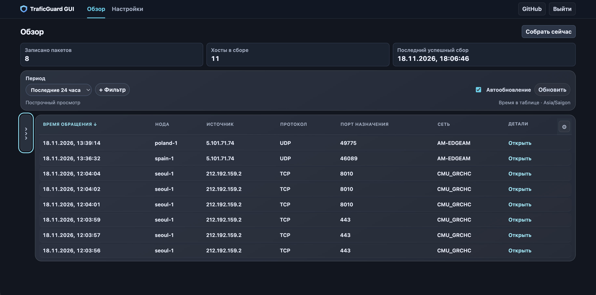

# TraficGuard GUI

> **Ранний тестовый прототип. Проект очень сырой, и вообще жесткий вайбкодинг.** Интерфейс, настройки и
> формат хранения ещё могут меняться. Проверяйте на тестовых нодах и
> держите панель на localhost или за SSH-туннелем. Для продакшена и
> открытого доступа из интернета эта сборка пока не готова.

Веб-панель собирает по SSH события с нескольких нод и хранит их в SQLite.
На каждой ноде отдельно устанавливается оригинальный
[TrafficGuard от dotX12](https://github.com/dotX12/traffic-guard).
Панель читает статистику и состояние правил в рамках диагностики.



## Запуск

Нужны Docker и Docker Compose.

```sh
git clone https://github.com/DalasDV/traffic-guard-gui.git
cd traffic-guard-gui
./start.sh
```

Откройте [127.0.0.1:4090](http://127.0.0.1:4090/). Для первого входа
используйте `guard / guard`, задайте новый пароль и настройте TOTP по
QR-коду. В «Настройки → Учётные данные» добавьте SSH-ключ, затем создайте
хост и нажмите «Проверить». В этом же разделе есть
[инструкция для отдельного SSH-пользователя](static/ssh-guide.md) с
ограниченным доступом к статистике.

## Что важно знать

- На чистом Debian мастер оригинального TrafficGuard может сообщить об успехе, хотя
  настрока сбора CSV сорвалась из-за отсутствия rsyslog. На ноде под root заранее перед установкой
  выполните `apt-get update && apt-get install rsyslog logrotate whois`,
  затем настройте TrafficGuard в full редиме как указано в оригинальном проекте.
- IP источника, протокол и порт берутся из журнала ядра. CSV добавляет
  ASN и название сети. При недоступном CSV события продолжают
  сохраняться. Таблица показывает записанные firewall пакеты с учётом
  его лимитов логирования.
- Первый сбор читает до 24 часов доступного журнала. Затем сборщик
  продолжает с последней записи. По умолчанию опрос идёт каждые 30 секунд,
  история хранится 30 дней. Длительная остановка сборщика может привести
  к пропуску событий, если за это время нода вытеснит их из журнала.
- Панель на данный момент принимает предъявленный SSH-сервером ключ без проверки
  отпечатка.
- Docker-том `data` хранит базу, `keys` — ключ шифрования. Для
  восстановления нужны оба тома. `docker compose down -v` удаляет данные.

## Восстановление доступа при утере пароля или TOTP

```sh
docker compose run --rm setup reset-admin
```

Введите новый пароль дважды. Команда сбросит прежний TOTP и завершит
сеансы. При следующем входе с новым паролем отсканируйте новый QR-код.

## Локальные тесты

```sh
docker compose build viewer
docker run --rm --network none --entrypoint python -e PYTHONPATH=/app \
  -v "$PWD/tests:/tests:ro" resist-local/antiscan-viewer:local \
  -m unittest discover -s /tests
```
